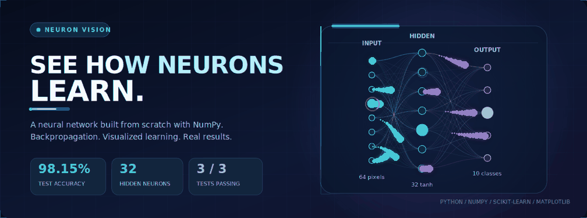
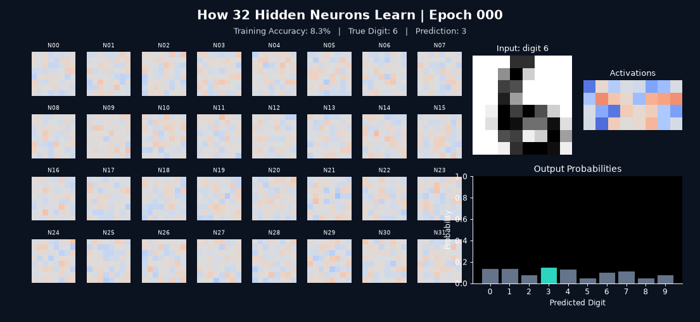
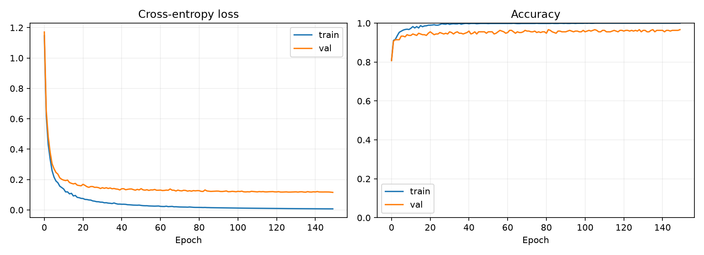
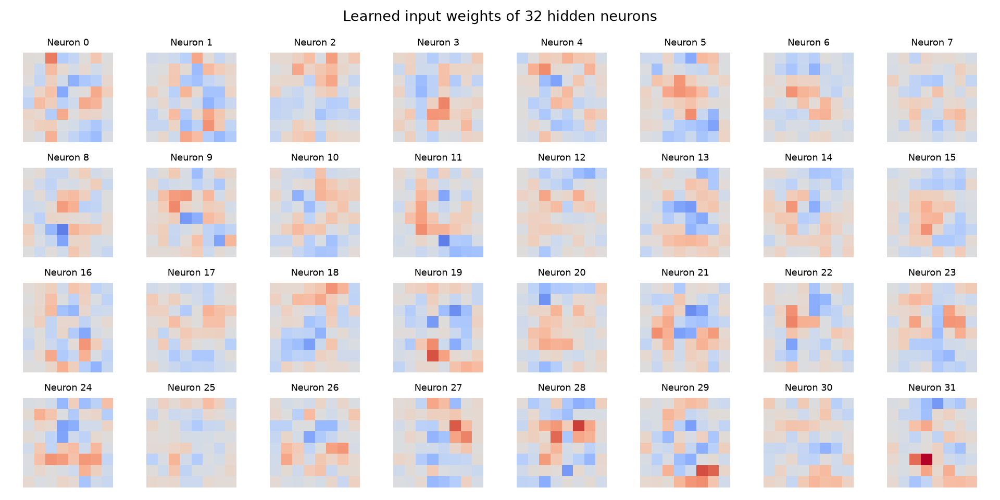

<div align="center">



### Watch a neural network learn — one neuron at a time.

**From-scratch NumPy MLP · Handwritten digit recognition · Interactive neuron exploration**

[](https://github.com/Mo22afa/neuron-vision-from-scratch/actions/workflows/tests.yml)
[](https://colab.research.google.com/github/Mo22afa/neuron-vision-from-scratch/blob/main/neuron_vision_colab.ipynb)


**[▶ Launch Interactive Colab](https://colab.research.google.com/github/Mo22afa/neuron-vision-from-scratch/blob/main/neuron_vision_colab.ipynb)** · **[View Source](src/neural_network.py)** · **[See Tests](tests/test_neural_network.py)**

</div>

---

## The demo: see learning in motion

<div align="center">



*32 learned 8×8 weight maps evolve across 150 epochs. The right panels show a sample input, hidden-layer activations, and output probabilities.*

</div>

> **What makes this project different?** It's not just a classifier. It exposes the learned weights of each hidden neuron, lets you inspect activations for different test digits, and checks backpropagation against numerical gradients — without a deep-learning framework.

## Results

| Metric | Result |
|:--|--:|
| Held-out test accuracy | **98.15%** |
| Test loss (cross-entropy) | **0.0772** |
| Train / validation / test examples | **1,257 / 270 / 270** |
| Dataset | scikit-learn Digits (1,797 images, 8×8 pixels) |
| Network | **64 → 32 → 10** |
| Hidden / output activations | tanh / softmax |
| Optimizer | Mini-batch SGD |
| Epochs | 150 |

Dataset splitting is stratified and seeded. The test set is never used to update weights.

## Inside the network · interactive insights

| Training and validation | Learned input weights of the 32 hidden neurons |
|:--:|:--:|
|  |  |

The heatmaps show each hidden neuron's **64 learned input weights**, reshaped into an 8×8 grid. They are learned feature patterns, not images generated by the network. The animation also shows the **hidden activations for one held-out digit** and the output probabilities across epochs.

In the [interactive notebook](neuron_vision_colab.ipynb), use sliders to select a test image and a hidden neuron to inspect its weights, activation, and class predictions.

## Under the hood

For a batch of input images `X`:

```text
hidden = tanh(X @ W1 + b1)
logits = hidden @ W2 + b2
probs  = softmax(logits)
loss   = mean(-log(probs[true_class]))
```

The model computes analytical derivatives using the chain rule and updates weights and biases with mini-batch gradient descent. A finite-difference test independently checks the gradients.

**No TensorFlow or PyTorch is used.**

## Try it yourself

Use the **Open in Colab** badge above for the full interactive experience.

To run the modular code locally (Python 3.10+):

```bash
pip install -r requirements.txt
python -m pytest -q tests
python -m src.train
python -m src.animate
```

Results are written to `outputs/` as model weights (`model.npz`), evaluation metrics, two charts, and an animated GIF. GitHub Actions automatically runs the tests and regenerates and publishes the visualizations on pushes to `main`.

## Repository structure

```text
neuron-vision-from-scratch/
├── neuron_vision_colab.ipynb     # Interactive notebook
├── src/
│   ├── __init__.py
│   ├── neural_network.py        # NumPy MLP + backpropagation
│   ├── train.py                 # Stratified data split + evaluation
│   └── animate.py               # Reproducible neuron animation
├── tests/
│   └── test_neural_network.py   # Softmax, gradients, training
├── outputs/
│   ├── metrics.json
│   ├── model.npz
│   ├── training_curves.png
│   ├── neuron_weights.png
│   └── neuron_learning.gif
├── .github/workflows/tests.yml
├── requirements.txt
├── .gitignore
└── README.md
```

## Limitations

- This is a small educational **MLP, not a CNN**.
- The images are only 8×8 pixels; results should not be generalized to unconstrained real-world handwriting.
- Neuron activations depend on the input; learned weights remain fixed after training.

## Tech stack

Python · NumPy · scikit-learn · Matplotlib · pytest · ipywidgets · Google Colab
